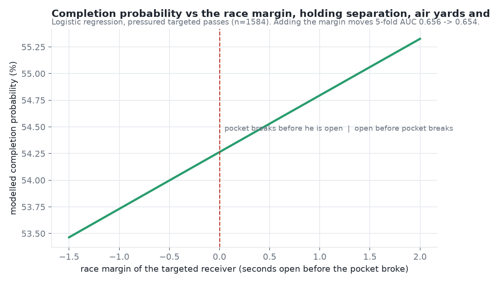

# THE RACE — Pocket Clock vs. Route Clock.

> **Site:** `index.html` is the viewer itself — 24 plays (race won, open man not thrown to, sacks) with the two clocks, a play picker and the findings underneath. Single-play mocks are in `output/race_tv_*.html`.




**What we built.** Every pass play is a race between two clocks: how fast the pass rush breaks the pocket, and how fast a receiver gets open. Using the 2021 Next Gen Stats tracking data (weeks 1–8, 122 games) joined to PFF's role labels, we compute both clocks on every dropback — the **pocket clock** (seconds from snap until a rusher is within 2 yds of the QB) and a **route clock** for every WR/TE/RB (seconds until he has 3 yds of separation from the nearest coverage defender *after* travelling 5 yds, so pre-snap cushion doesn't count) — and score who won.

**What it reveals.** Across 2,660 pressured dropbacks the pocket breaks at a median 2.7 s while the median route needs ~1.8 s to come open — yet when pressure arrives only 63% of WR routes (57% of TE, 71% of RB) have already won. The *Win-Rate-Under-Pressure* leaderboard separates receivers sharply: Baltimore's quick-game receivers (Marquise Brown 86%, Duvernay 83%, Proche 82%, Mark Andrews 77%) dominate and BAL is also #1 in *Protection–Route Sync* (first receiver open 1.4 s before the pocket breaks), while deep-route stars Davante Adams (40%) and Ja'Marr Chase (41%) sit at the bottom — the metric finds *hot-read* receivers who win early, not the best receivers overall. Existing stats measure *how much* separation a receiver gets at the throw; this measures *when* he gets it relative to the protection — the first public metric to put pass rush and route running on one clock, which became possible only when this dataset paired PFF rush/route roles with receiver tracking.

**Does winning the race matter? (validation, `team_report.py` and `model.py`)** Plays are joined to [nflverse](https://github.com/nflverse/nflverse-data) (`nflverse.py`) on `gameId`/`playId` (all 8,557 match) for EPA, win probability added, air yards, expected completion (`cp`) and CPOE, and for the targeted receiver **by player ID** instead of by parsing the play text. On 1,593 pressured, targeted passes (interceptions included), throwing to a receiver who had won his race completes **57%** of the time vs **48%** when he had not, and **+6.4 points above expected** by CPOE, which already accounts for air yards and situation. Average air yards are the same in both groups (11.0 vs 10.8), so this is not a "won races are just shorter throws" effect. The gap is where the race is decided: on short passes (< 15 air yards) **62% vs 49%**, CPOE −3.6 vs −14.4; on deep passes it disappears (43% vs 45%, CPOE 0.0 vs +5.1). Sack rate on pressured dropbacks falls from 30% when nobody wins to 17% when a receiver wins by more than a second. We then asked the harder question with a logistic regression (numpy, 5-fold CV): does the race margin predict completion *beyond* what is already known? Beyond separation at the throw: no (AUC 0.656 → 0.654). Beyond nflverse's public expected-completion model: barely (0.651 → 0.654). Our reading: the race is the **timing decomposition of separation**: the same information, available before the throw and attributable to a player and a moment. That is what makes it usable on a broadcast and in a game plan; it is not a new predictor of completion.

> **Correction to earlier numbers.** The first version reported 73% vs 60% on 1,290 targets. That matched targets by parsing the play text, and the parser kept the trailing full stop on lines like `pass incomplete short left to A.Cooper.`, so about 300 incompletions never matched a receiver and both completion rates were inflated. Interceptions were also left out. The nflverse ID join fixes both; every number above uses it.

**Value, not just timing (`make_charts.py`, `output/chart_value.png`).** Among WR/TE with 80+ routes and 20+ targets, win rate under pressure is nearly uncorrelated with EPA per target (r = +0.07) and with NGS average separation at the catch point (r = +0.03). The first says winning early is not the same as being valuable: Ja'Marr Chase wins 41% of pressured races but is among the group's best at +1.00 EPA per target. The second says the race is not NGS separation under another name. `race_players.csv` now carries EPA per target, aDOT, CPOE and NGS separation next to the race columns, and `race_teams.csv` carries EPA per dropback.

**Robustness (`model.py`, 30-game subset).** The median pocket clock stays 2.5–2.8 s and first-open 1.7 s across pressure radii of 1.5–2.5 yd and open thresholds of 2.5–3.5 yd, and the sack-rate gap (nobody won vs someone won) persists in every setting. The completion gap for the targeted receiver is small on 30 games (59% vs 56% at the baseline), holds at a 2.5 yd radius (61% vs 58%) and reverses at 1.5 yd (44% vs 49%, n=188, where only 19% of plays count as pressured). Player rankings on 30 games are noisy and should be read from the full 8 weeks. Table: `output/robustness.csv`.

**For teams (`team_report.py`).** *Protection exchange rate*: keeping extra RB/TEs in to block is measured as pocket time bought vs. route clock lost. League-wide, against **man** coverage one extra blocker buys **no** pocket time (2.6 → 2.5 s) while cutting race-won rate from 88% to 83%; against **zone**, two extra blockers buy +0.6 s. With nflverse EPA the exchange also has a price: against man, one extra blocker moves EPA per dropback from +0.15 to +0.19, and against zone from +0.07 to +0.18 (`epa_change` in `protection_exchange.csv`; descriptive, not adjusted for situation). *Defense cards*: for every opponent, pocket clock and race-won-allowed by coverage call (e.g. "attack their Cover-2 with quick game, they break the pocket at 2.3 s"). Per-team cards: `python team_report.py --team DAL`.


**What exists vs. what's new**

| Already public | This project |
|---|---|
| NGS *average separation* — how much space at the throw | **When** the space arrived, relative to the protection |
| NGS *time to throw*, PFF *pressure rate* — the pass rush alone | Pass rush and routes **on the same clock, per play** |
| PFF pass-blocking grades (paywalled) | **Exchange rate**: pocket time bought vs. receivers given up, by coverage |
| 2023 Big Data Bowl: linemen and rushers only | Receivers (WR/TE/RB) measured against that pass rush |

**Who uses it.** Broadcasters get a live TV graphic (`race_tv.py`: two clocks racing above the play, in the spirit of the IPL's required-run-rate bar) showing what the play was worth (EPA and win-probability swing from nflverse), with an AI on-air call generated from the clock numbers by a local LLM (`race_commentary.py`, Qwen via Ollama, rule-based fallback); scouts get receivers who win fast rather than receivers who are merely open; coaches get a team sync number that says "call quicker routes" or "keep a blocker in."

**Run it.**
```
python nflverse.py              # optional check: downloads nflverse 2021 pbp, players, NGS (~25 MB, once) and prints the join report
python compute_race.py          # ~4 min, all 122 games -> output/race_routes.csv, race_players.csv, race_teams.csv
python make_charts.py           # -> output/chart_receivers.png, chart_teams.png, chart_positions.png, chart_value.png
python race_tv.py               # -> output/race_tv_<game>_<play>.html  (broadcast mock; open in a browser)
python race_tv.py --game 2021090900 --play 687
python race_commentary.py --game 2021090900 --play 687 --inject   # AI on-air call via local Qwen (Ollama); template fallback
python team_report.py --team BAL   # -> validation_target.csv, protection_exchange.csv, defense_cards.csv + charts
python model.py                     # -> model_results.csv, robustness.csv, chart_model.png (numpy logistic regression)
RACE_PRESSURE=1.5 python compute_race.py --games 30   # sensitivity run (also RACE_OPEN, RACE_STEM); feeds model.py
python build_site.py                # -> index.html, the play viewer with 24 embedded plays
```
Requires pandas, numpy, matplotlib, pyarrow (`pip install -r requirements.txt`). nflverse files are downloaded on first run into `output/cache/nflverse/` (gitignored); if the download fails, the pipeline still runs, falls back to parsing the play text for the target, and leaves the value columns empty. Optional: Ollama + `ollama create race-caller -f Modelfile` for the AI on-air call. Data folder `nfl-big-data-bowl-regional-event-data-main/data/` sits beside the scripts.

**Assumptions & limitations.** The route clock rewards quick-developing routes by design: a deep route that comes open at 2.4 s "loses" to a 2.2 s pocket even if it would have produced a 40-yard gain, so this is a measure of timing, not of total receiving value; the nflverse join confirms that (r = +0.07 with EPA per target). On pressured dropbacks, plays where someone won the race average lower EPA than plays where nobody did (−0.30 vs −0.11), but the nobody-won group is small (n=136) and includes scrambles and quick checkdowns, so we do not read anything into it yet. EPA and CPOE are nflverse model outputs, not ground truth. Matchups are inferred as the nearest coverage defender (PFF does not label assignments). Thresholds (2 yds pressure, 3 yds open, 5 yd stem, no win before 1.0 s) are football-reasonable but not tuned; the tracking stops at the throw, so the metric describes the race up to the release, not the catch. Eight weeks of data: receiver estimates use a 30-route minimum and should still be read with error bars in mind.
