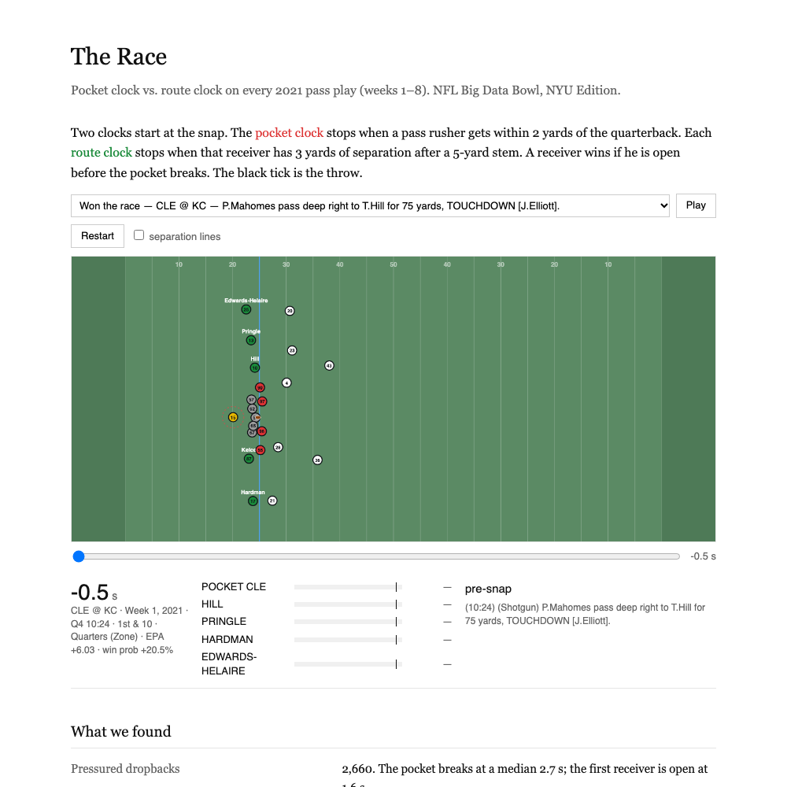
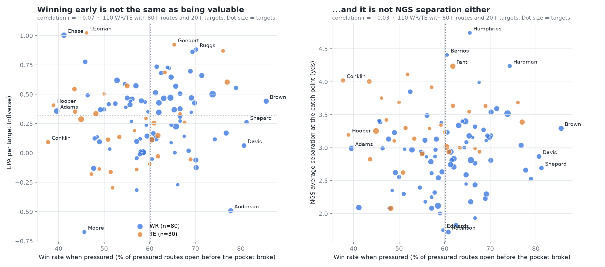

# The Race: pocket clock vs. route clock

**Site:** https://subhradeep246.github.io/NYUgiants/ · **Video (1 min):** [`output/the_race.mp4`](output/the_race.mp4)

**What we built.** A metric that times every 2021 pass play (weeks 1–8) as a race between two clocks. The **pocket clock** is the seconds until a pass rusher gets within 2 yards of the QB. Each WR, TE and RB has a **route clock**: the seconds until he has 3 yards of separation after a 5-yard stem. A receiver **wins** if he is open before the pocket breaks.

**What insight it reveals.** Under pressure, a throw to a receiver who won his race completes 57% of the time vs 48% when he hadn't won. That is **+6.4 points above expected** (nflverse CPOE) at the same throw depth. The sack rate also falls from 30% to 17% when someone wins by more than a second. Receivers split sharply: Baltimore's quick game wins most often (Marquise Brown 86%, Devin Duvernay 83%). Davante Adams (40%) and Ja'Marr Chase (41%) rarely win before the pocket breaks yet still produce high EPA per target, so the race measures timing, not overall value.

**Who would use it.**
- **Broadcasters:** a live two-clock graphic that shows a receiver getting open as the pocket closes, with the play's EPA and win-probability swing.
- **Scouts:** a leaderboard of receivers who give the QB an early answer under pressure.
- **Coaches:** what keeping a blocker in really buys. Against man coverage, one extra blocker buys no pocket time and cuts the race-won rate from 88% to 83%.




## Findings

| | |
|---|---|
| Pressured dropbacks | 2,660; the pocket breaks at a median 2.7 s, and the first receiver is open at 1.6 s |
| Target won vs lost (pressured, n = 1,593) | 57% vs 48% completion, CPOE −2.6 vs −9.0, air yards 11.0 vs 10.8 |
| Short passes (under 15 air yards) | 62% vs 49%. On deep passes there is no gap (43% vs 45%) |
| Sack rate, pressured | 30% when nobody wins, 17% when a receiver wins by more than 1 s |
| Already open when the pocket breaks | WR 63%, TE 57%, RB 71% |
| Extra blocker vs man coverage | Pocket clock 2.6 → 2.5 s (no time bought); race won 88% → 83% |





## Method

- **Data:** Next Gen Stats tracking (all 122 games), joined to PFF roles (Pass Route, Coverage, Pass Rush, Pass) and to free [nflverse](https://github.com/nflverse/nflverse-data) play-by-play on `gameId`/`playId`. That join supplies EPA, win probability, air yards, CPOE, and the targeted receiver by player ID.
- **Clocks:** coordinates are normalized so every offense moves left to right. The clocks run from `ball_snap` to the first of pass / sack / scramble, and neither clock can be won before 1.0 s.
- **Validation:** `team_report.py` compares completion, CPOE and sack rate by race outcome. `model.py` fits a numpy logistic regression with 5-fold cross-validation and re-runs the headline numbers under other thresholds.

## Assumptions and limitations

- **It measures timing, not value.** Win rate barely correlates with EPA per target (r = +0.07) or with NGS separation (r = +0.03). In the model, the race margin adds almost nothing beyond separation at the throw or nflverse's expected completion (AUC 0.651 → 0.654).
- **Matchups are inferred.** Each receiver is matched to his nearest coverage defender, because PFF does not label assignments.
- **The thresholds weren't tuned.** We used 2, 3 and 5 yards. On a 30-game check, the sack-rate gap holds at every setting, but the completion gap shrinks, and it reverses at a 1.5-yard pressure radius.
- **Tracking stops at the throw**, so the race says nothing about the catch.
- **The sample is eight weeks.** Read player rankings with error bars in mind. EPA and CPOE are nflverse model outputs, not ground truth.

## Run it

```
pip install -r requirements.txt      # pandas, numpy, matplotlib, pyarrow
python compute_race.py               # clocks for every receiver-play (~4 min); downloads nflverse once
python team_report.py                # validation, protection exchange, defense cards
python model.py                      # completion model + threshold robustness
python make_charts.py                # charts in output/
python build_site.py                 # index.html: play viewer with 24 plays
python race_tv.py --game 2021091209 --play 3093   # single-play broadcast mock
```

Put the Big Data Bowl data in `nfl-big-data-bowl-regional-event-data-main/data/` next to the scripts. If the nflverse download fails, the pipeline still runs without the value columns. `race_commentary.py` optionally adds a one-line AI call from a local Qwen model via Ollama.
