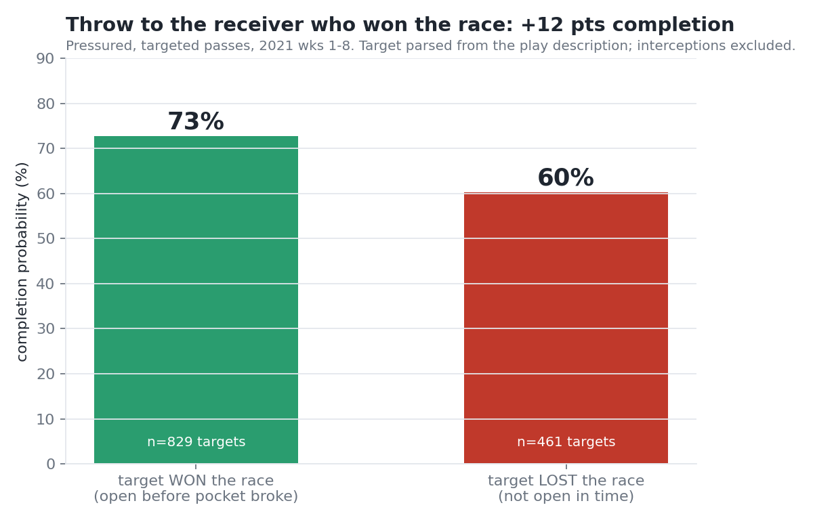
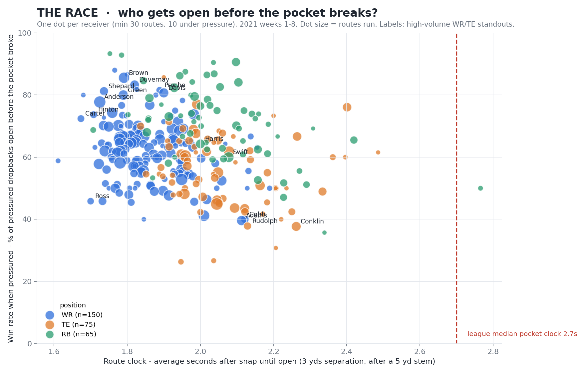
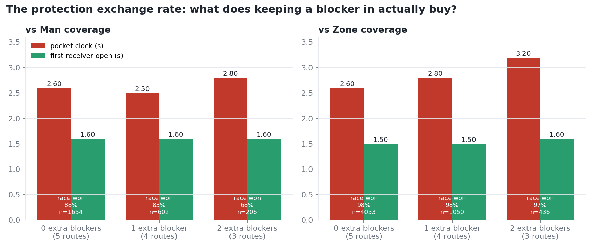
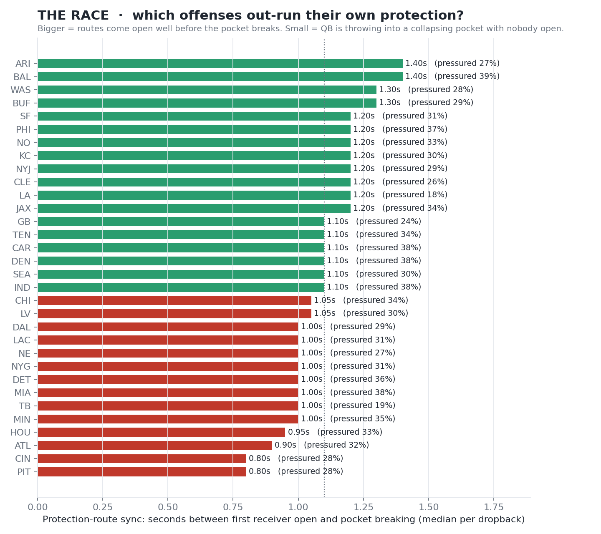

# THE RACE — Pocket Clock vs. Route Clock

> **Broadcast mock:** open `output/race_tv_2021090900_687.html` in a browser, click **Lower-third**, press Play.



**What we built.** Every pass play is a race between two clocks: how fast the pass rush breaks the pocket, and how fast a receiver gets open. Using the 2021 Next Gen Stats tracking data (weeks 1–8, 122 games) joined to PFF's role labels, we compute both clocks on every dropback — the **pocket clock** (seconds from snap until a rusher is within 2 yds of the QB) and a **route clock** for every WR/TE/RB (seconds until he has 3 yds of separation from the nearest coverage defender *after* travelling 5 yds, so pre-snap cushion doesn't count) — and score who won.

**What it reveals.** Across 2,649 pressured dropbacks the pocket breaks at a median 2.7 s while the median route needs ~1.8 s to come open — yet when pressure arrives only 63% of WR routes (57% of TE, 71% of RB) have already won. The *Win-Rate-Under-Pressure* leaderboard separates receivers sharply: Baltimore's quick-game receivers (Marquise Brown 86%, Duvernay 83%, Proche 82%, Mark Andrews 77%) dominate and BAL is also #1 in *Protection–Route Sync* (first receiver open 1.4 s before the pocket breaks), while deep-route stars Davante Adams (40%) and Ja'Marr Chase (41%) sit at the bottom — the metric finds *hot-read* receivers who win early, not the best receivers overall. Existing stats measure *how much* separation a receiver gets at the throw; this measures *when* he gets it relative to the protection — the first public metric to put pass rush and route running on one clock, which became possible only when this dataset paired PFF rush/route roles with receiver tracking.

**Does winning the race matter? (validation)** On 1,290 pressured, targeted passes, throwing to a receiver who had won his race completes **73%** of the time vs **60%** when the target was not yet open — a 12-point swing in completion probability; sack rate on pressured dropbacks falls from 30% when nobody wins to 17% when a receiver wins by more than a second.



**For teams (`team_report.py`).** *Protection exchange rate*: keeping extra RB/TEs in to block is measured as pocket time bought vs. route clock lost. League-wide, against **man** coverage one extra blocker buys **no** pocket time (2.6 → 2.5 s) while cutting race-won rate from 88% to 83%; against **zone**, two extra blockers buy +0.6 s. *Defense cards*: for every opponent, pocket clock and race-won-allowed by coverage call (e.g. "attack their Cover-2 with quick game, they break the pocket at 2.3 s"). Per-team cards: `python team_report.py --team DAL`.




**Who uses it.** Broadcasters get a live TV graphic (`race_tv.py`: two clocks racing above the play, in the spirit of the IPL's required-run-rate bar); scouts get receivers who win fast rather than receivers who are merely open; coaches get a team sync number that says "call quicker routes" or "keep a blocker in."

**Run it.**
```
python compute_race.py          # ~4 min, all 122 games -> output/race_routes.csv, race_players.csv, race_teams.csv
python make_charts.py           # -> output/chart_receivers.png, chart_teams.png, chart_positions.png
python race_tv.py               # -> output/race_tv_<game>_<play>.html  (broadcast mock; open in a browser)
python race_tv.py --game 2021090900 --play 687
python team_report.py --team BAL   # -> validation_target.csv, protection_exchange.csv, defense_cards.csv + charts
```
Requires pandas, numpy, matplotlib. Data folder `nfl-big-data-bowl-regional-event-data-main/data/` sits beside the scripts.

**Assumptions & limitations.** The route clock rewards quick-developing routes by design: a deep route that comes open at 2.4 s "loses" to a 2.2 s pocket even if it would have produced a 40-yard gain, so this is a measure of timing, not of total receiving value — pairing it with air yards / EPA from nflverse is the obvious next step. Matchups are inferred as the nearest coverage defender (PFF does not label assignments). Thresholds (2 yds pressure, 3 yds open, 5 yd stem, no win before 1.0 s) are football-reasonable but not tuned; the tracking stops at the throw, so the metric describes the race up to the release, not the catch. Eight weeks of data: receiver estimates use a 30-route minimum and should still be read with error bars in mind.
